## Цели курса

Освоить базовые, серверные и продвинутые возможности Linux, выполнить интерактивные задания на платформе Stepik.

## Результат

Пройдено 3 этапа, выполнено 99 заданий, получены сертификаты. Итоговый сайт с отчётом опубликован.

---

## Этап 1: Введение в Linux

### 1.1 Общая информация о курсе

Выбираю правильное названия курса и отправляю ответ.

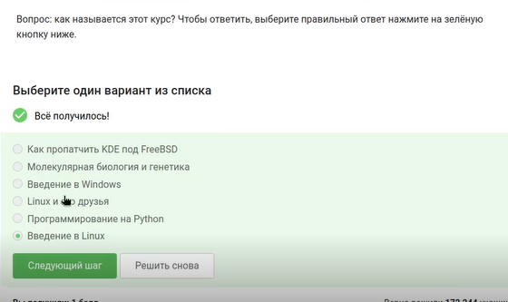

Выбираю нужные пункты и отправляю решение.

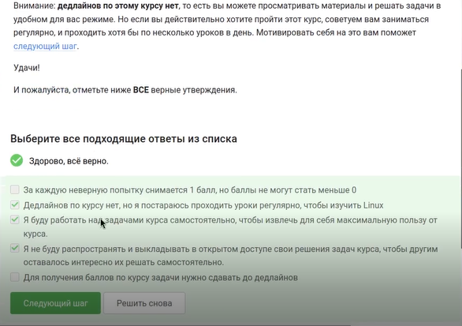

### 1.2 Как установить Linux

Отвечаю какими операционными системами я пользуюсь.

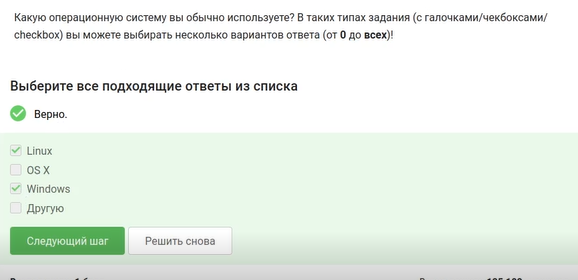

Для вопроса «Что такое виртуальная машина?» выбран наиболее полный ответ: «Специальная программа для запуска одной ОС на другой ОС».

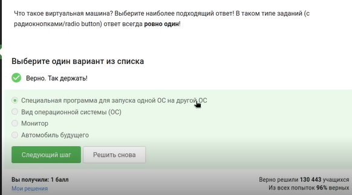

Отвечаю, что получилось запустить Linux и отправляю ответ.

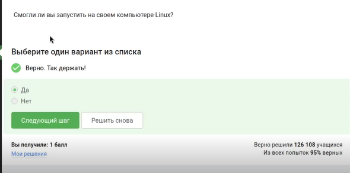

### 1.3 Осваиваем Linux

Создаю документ в предложенном текстовом редакторе, выбираю нужный шрифт и ввожу предложение.

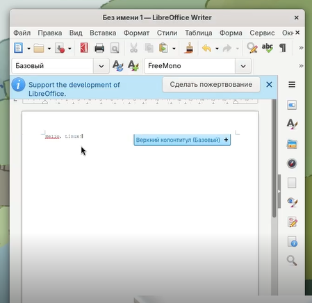

Сохраняю в формате xml и отправляю ответ.

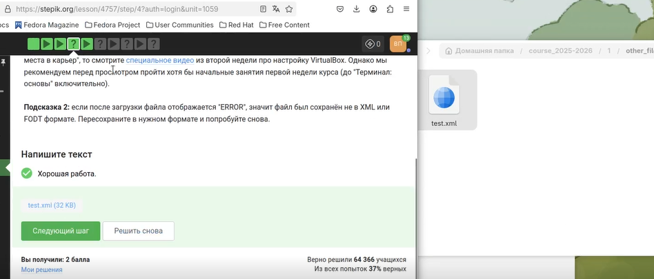

Выбираю нужное расширение deb, так как оно имеет установочные пакеты в Linux (Ubuntu).

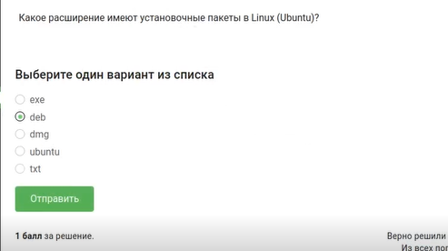

Прописываю команду sudo dnf install, чтобы скачать vcl.

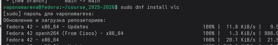

Открываю скачанную программу, захожу в авторов и ввожу фамилию самого первого.

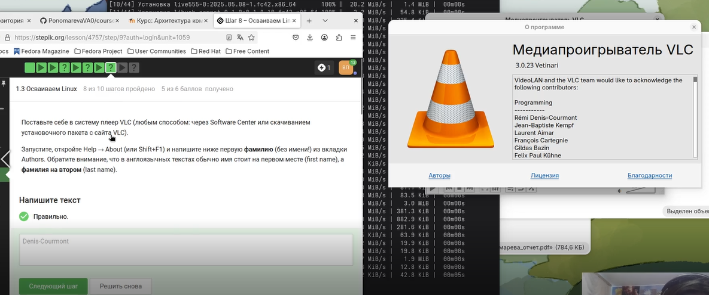

Для вопроса о назначении Update Manager выбраны правильные пункты: «Для обновления всей системы до новой версии» и «Для обновления ссылок в Software Center» (последнее — специфика данного теста).

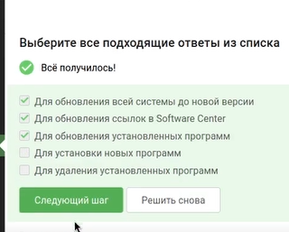

### 1.4 Terminal: основы

Выбраны все синонимы для «командной строки»: «Терминал» и «Консоль». Варианты «Ассоль» и «Термин» не являются синонимами в данном контексте.

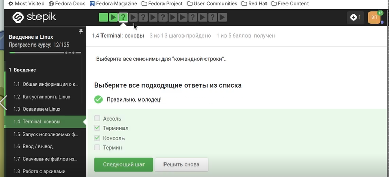

Выбираю pwd, потому что эта команда показывает в какой директории мы сейчас находимся.

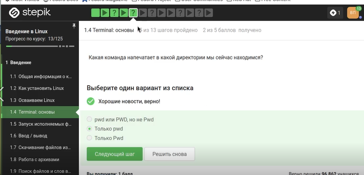

Для команды ls -A --human-readable -l /some/directory отмечены эквивалентные варианты: ls -lAh /some/directory, ls -Ahl /some/directory, ls -h -A -l /some/directory. Все они используют группировку опций -A (почти все файлы), -h (человеко‑читаемые размеры) и -l (длинный формат).

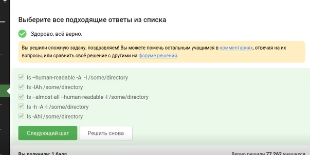

Из директории /home/bi/Documents нужно вывести содержимое /home/bi/Downloads. Выбран верный относительный путь: ls ../Downloads (подъём на уровень вверх и переход в папку Downloads). Вариант с ls /home/bi/Do* не отмечен, так как вывел бы и Documents, и Downloads.

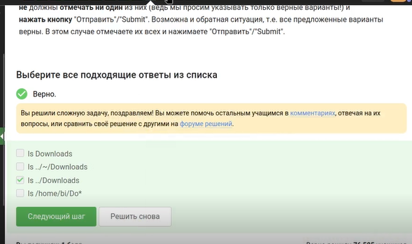

Вопрос о команде удаления директорий. Правильный ответ — rm -r (рекурсивное удаление). mkdir создаёт, mv перемещает, rm -f удаляет файлы без подтверждения, но не директории.

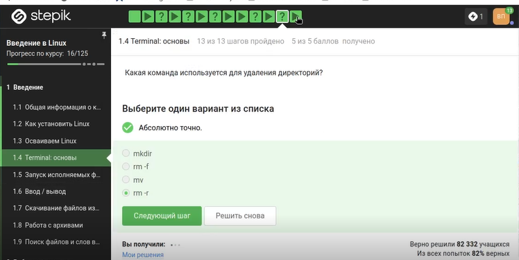

### 1.5 Запуск исполняемых файлов

Выбран верный вариант ответа.

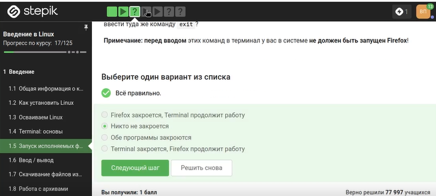

Запуск программы с символом & переводит её в фоновый режим. Этому эквивалентна последовательность: запуск программы, затем нажатие Ctrl+Z (остановка), затем команда bg (возобновление в фоне).

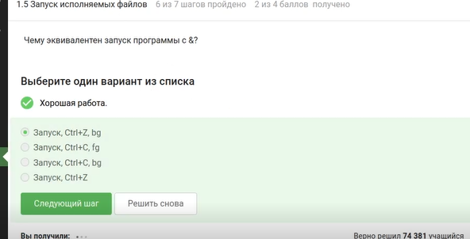

Перехожу в нужную директорию и ввожу команды, чтобы файл сделать исполняемым.

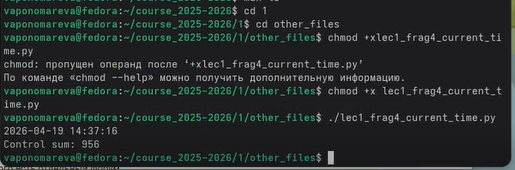

После запуска программа вывела на экран две строки: текущую дату и время (2026-04-19 14:37:16) и контрольную сумму (Control sum: 956). Этот текст скопирован в форму ответа, задание выполнено полностью.

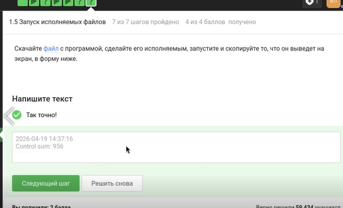

### 1.6 Ввод/вывод

Выбираю что поток ошибок выводится на экран.

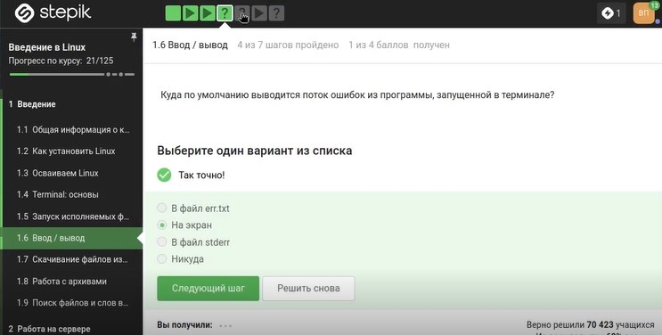

Выбраны команды, которые создают файл file.txt и записывают в него только поток ошибок (stderr) программы program: program 2> file.txt (перезапись) и program 2>> file.txt (добавление в конец).

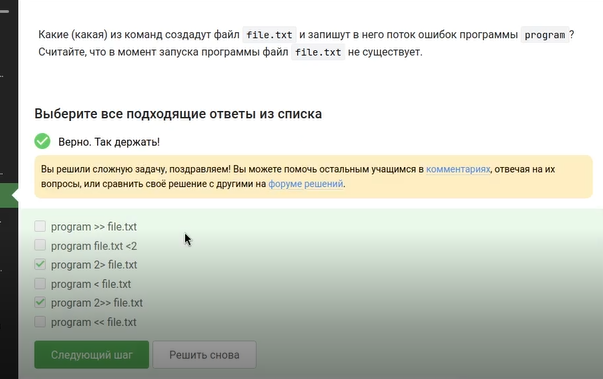

Вопрос о том, куда попадают сообщения об ошибках (stderr) в конвейере (pipe). Правильный ответ: «Выводятся на экран», потому что по умолчанию конвейер передаёт только stdout, а stderr остаётся на терминале.

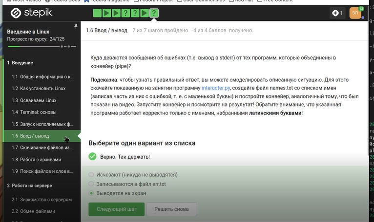

### 1.7 Скачивание файлов из интернета

Выбираю правильный ответ.

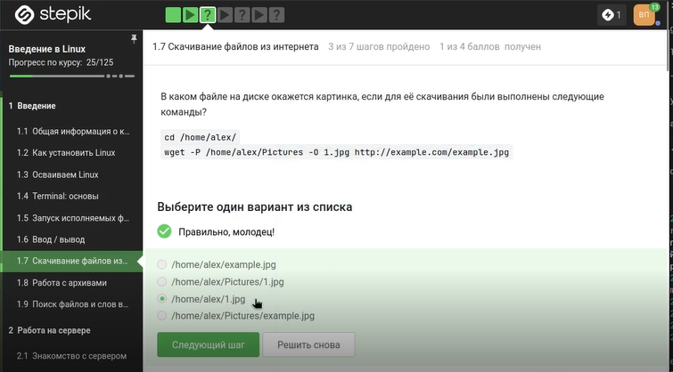

Для команды wget требуется опция, подавляющая вывод любых сообщений (Resolving..., Connecting to...). Правильный ответ: -q или --quiet (от английского quiet — тихий). Опции -v (verbose) и -nv (no-verbose) не отключают вывод полностью.

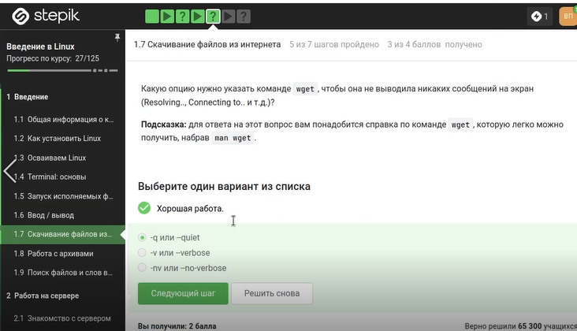

В тесте выбран правильный сценарий работы wget с заданными опциями (например, рекурсивная загрузка с ограничением по типам файлов).

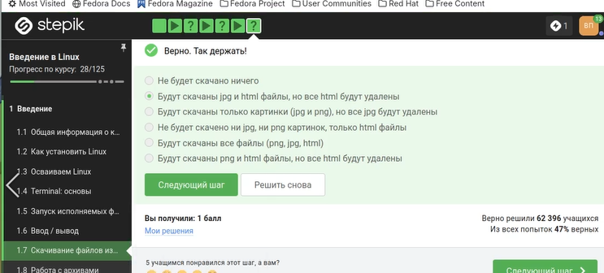

### 1.8 Работа с архивами

Вопрос об отличии gzip от zip при использовании по умолчанию. Правильный ответ: gzip удаляет архив после его распаковки (если не использовать опцию -k). zip сохраняет архив после распаковки.

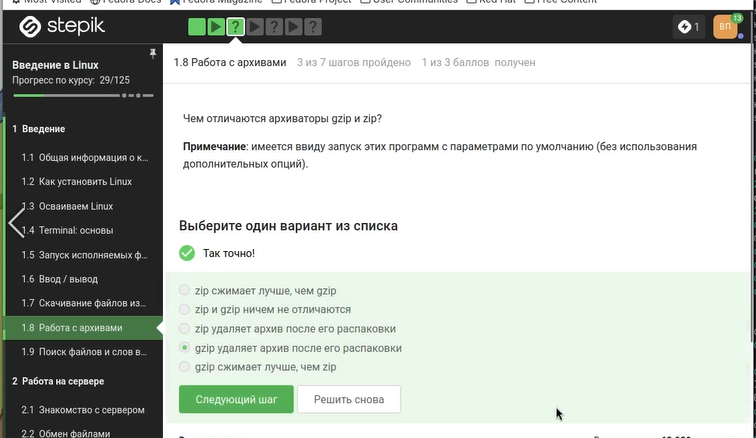

Выбраны архиваторы, способные создать архив из директории: zip (может упаковать папку рекурсивно) и tar (создаёт tar-архив, который затем можно сжать). gzip сам по себе сжимает только один файл и не умеет упаковывать директорию без tar.

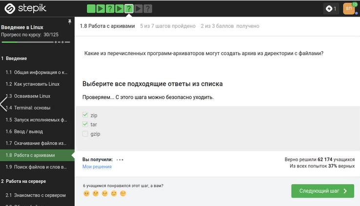

Для распаковки архива .tar.gz используется комбинация опций tar -xzf: -x (extract), -z (через gzip), -f (файл). Другие варианты (-czf — создание, -xjf — для bz2, -wlf — несуществующая опция) не подходят.

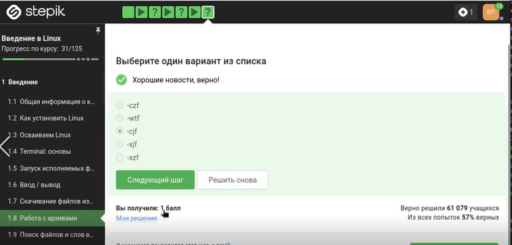

### 1.9 Поиск файлов и слов в файлах

Для файла Alexey.jpeg отмечены маски команды find, которые НЕ найдут этот файл: *.jpg (расширение .jpg, а не .jpeg) и alexey.* (имя с маленькой буквы, а в файле — с большой). Маски Alex*, *.*, Alexey.jpeg, *?* нашли бы файл.

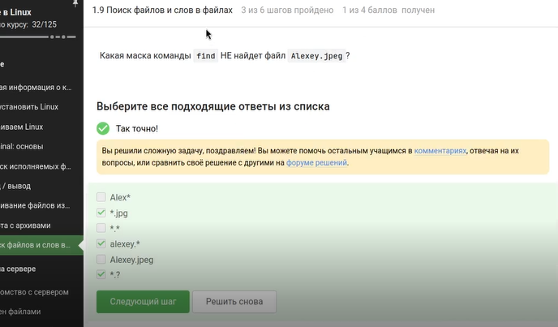

Команда grep "world" text.txt ищет точное вхождение world (с учётом регистра, если не указано -i). Выведены строки: The "world" is not enough, world, The world is not enough. Строки с World, The World Is Not Enough и другие варианты с заглавной буквы или дефисом не выводятся.

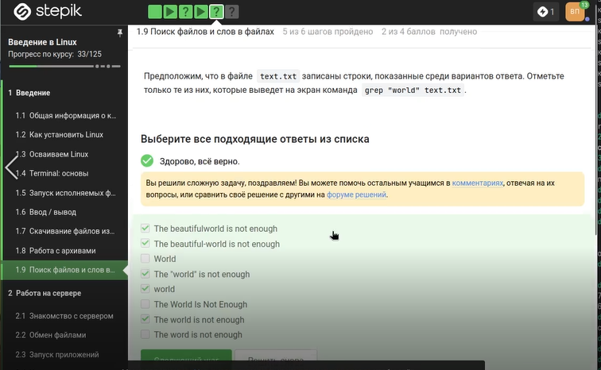

Ввожу нужные команды в терминал, чтобы сгенерировать файл, в котором будут все строчки из этих произведений, содержащие "love".

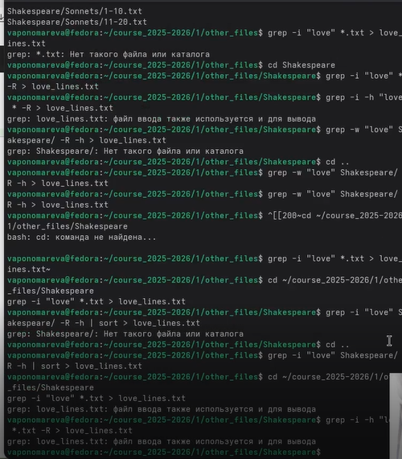

Загружаю этот файл на платформу.

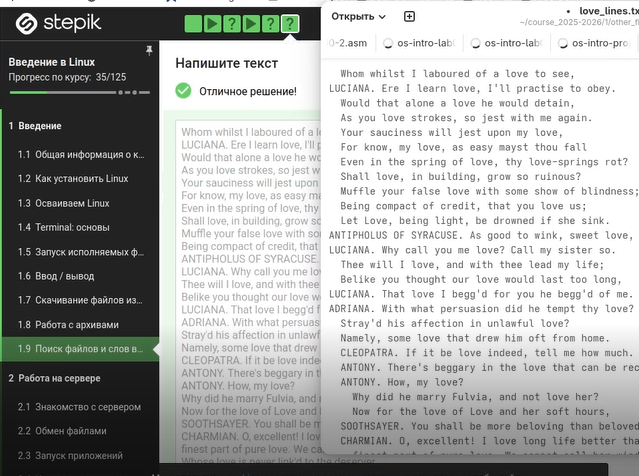

---

## Этап 2: Работа на сервере

### 2.1 Знакомство с сервером

Выбираю для каких задач можно использовать сервер и отправляю ответ.

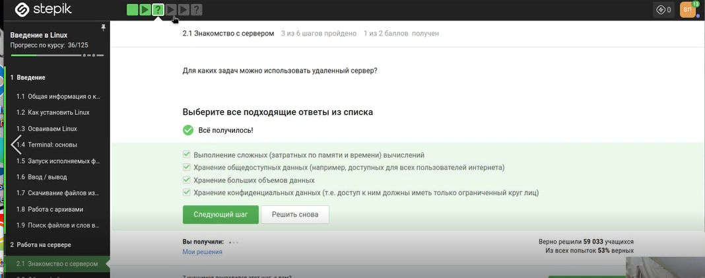

При SSH-аутентификации используется пара ключей: закрытый (id_rsa) и открытый (id_rsa.pub). Закрытый ключ должен храниться в секрете и никогда не передаваться.

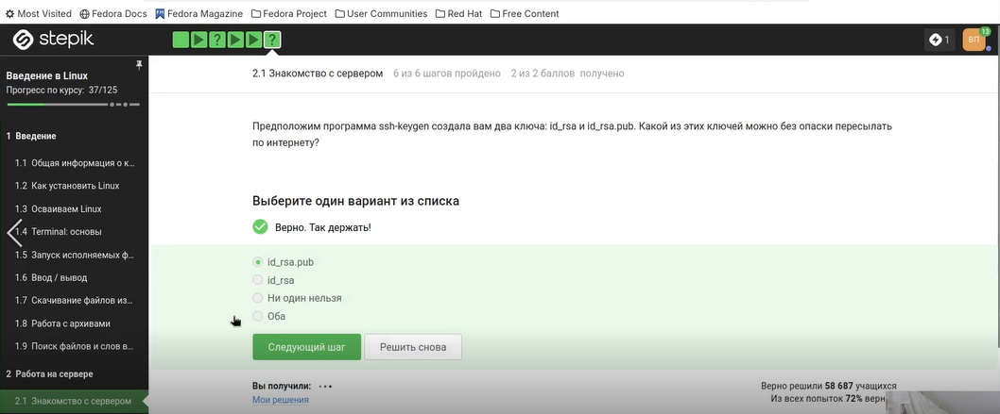

### 2.2 Обмен файлами

scp — команда для копирования по SSH, -r — рекурсивное копирование (нужно для папок), stepic — копируемая папка, username@server:~/ — пользователь, сервер и целевая директория (домашняя). Варианты с ssh неверны (ssh — для подключения, а не копирования). Вариант без -r скопирует только файлы верхнего уровня без подпапок.

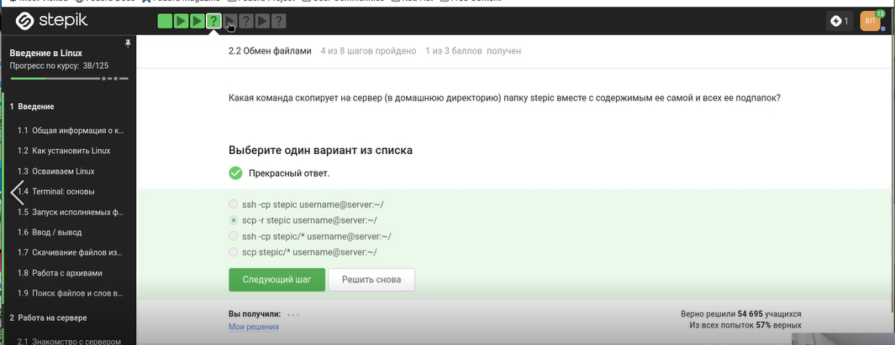

Ошибка «не может найти и скачать пакет» часто возникает из-за устаревшего списка пакетов. Команда apt-get update обновляет этот список.

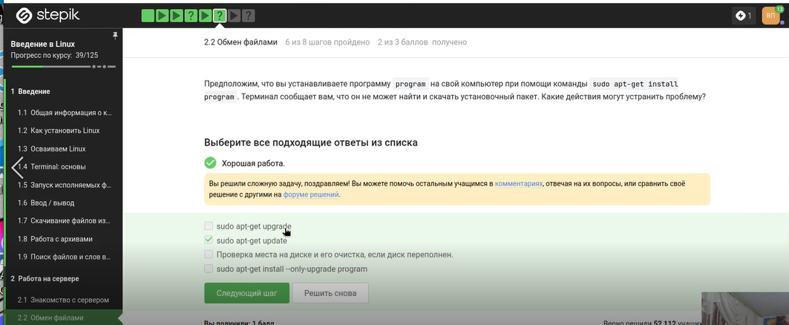

FileZilla — FTP-клиент. Его основные функции: просматривать файлы на сервере (правая панель), загружать файлы с компьютера на сервер и скачивать с сервера на компьютер. Он не предназначен для запуска программ на сервере или их установки — для этого нужен SSH.

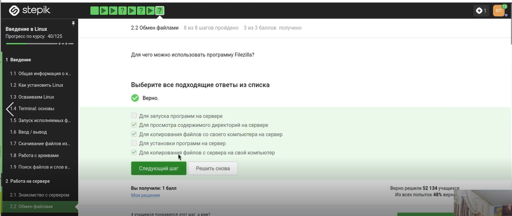

### 2.3 Запуск приложений

На сервере обычно нет графического экрана. Если программа требует GUI, есть два разумных решения: найти её консольный аналог (многие программы имеют -cli версию) или скопировать данные на локальный компьютер и запустить программу там. «Настроить сервер для вывода на экран» невозможно в обычном смысле, а «ничего сделать нельзя» — неверно, так как способы есть.

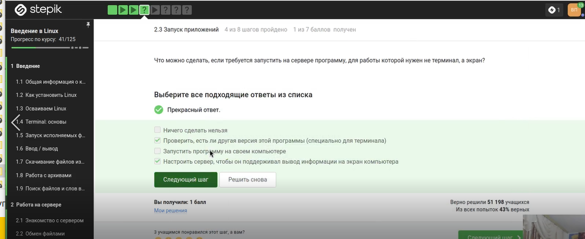

program --help (или -h) выводит краткую справку. man program — полное руководство. Команда help program работает только для встроенных команд оболочки (например, help cd).

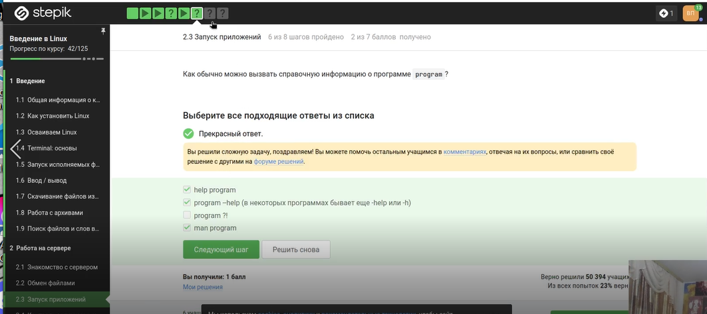

FastQC анализирует данные секвенирования. Основной входной формат — FASTQ (fastq). Также он умеет работать с BAM/SAM файлами, а опции bam_mapped / sam_mapped указывают анализировать только выравненные чтения. seq — не формат для FastQC, fastqc — название самой программы.

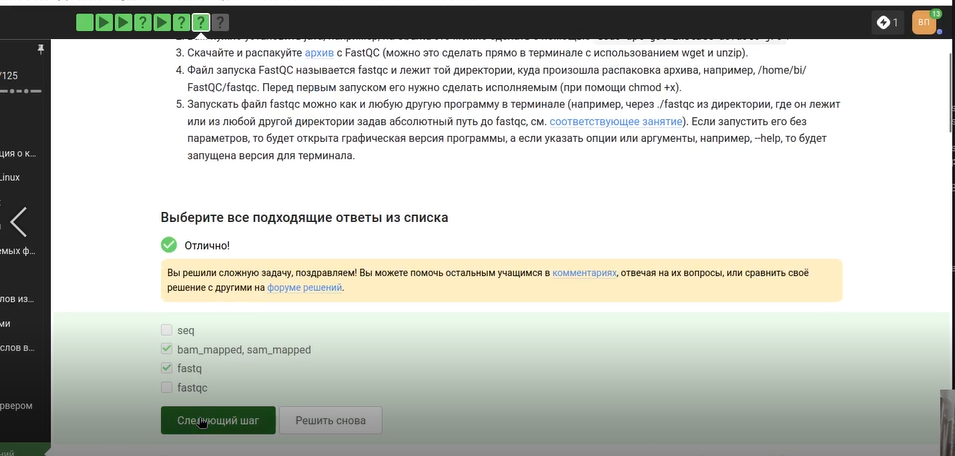

ClustalW (или Clustal Omega) используется для множественного выравнивания последовательностей. Команда clustalw test.fasta -align означает: взять входной файл test.fasta и выполнить выравнивание. Синтаксис корректен для классической версии ClustalW.

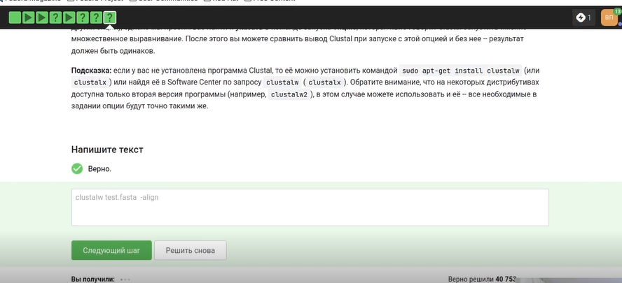

### 2.4 Контроль запускаемых программ

Исходно три программы запущены в фоне. fg %1 — program1 выводится на передний план. Ctrl+C — program1 завершается. fg %2 — program2 на переднем плане. Ctrl+Z — program2 останавливается (но остаётся в списке jobs). program3 всё это время был в фоне. Команда jobs показывает остановленные и фоновые процессы — это program2 (остановлен) и program3 (фон). program1 завершён и не показывается.

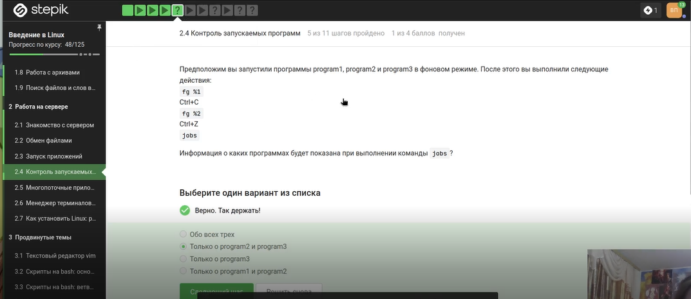

Выбираю правильный ответ и отправляю его.

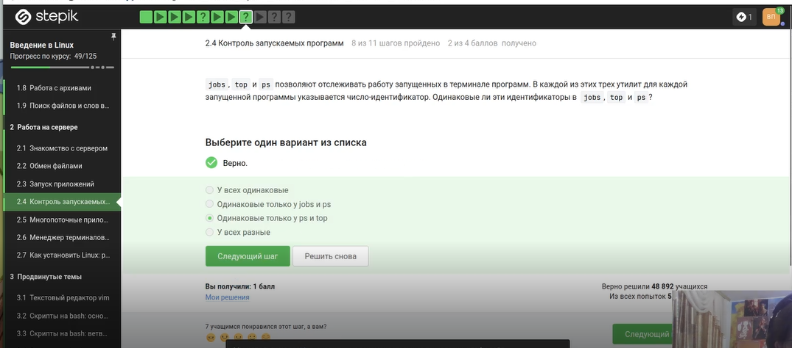

kill -9 (сигнал SIGKILL) мгновенно завершает процесс, процесс не может его перехватить или игнорировать. Обычный kill (без опций) отправляет сигнал SIGTERM («вежливое» завершение), который процесс может обработать или проигнорировать.

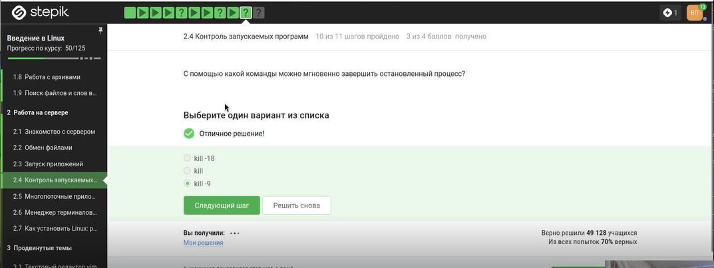

Процесс, остановленный Ctrl+Z, находится в состоянии «остановлен» (T). При отправке ему сигнала SIGTERM (обычный kill) он не завершается мгновенно, потому что остановлен. Он перейдёт в состояние «завершающийся» и завершится, когда будет продолжен. Но на практике в большинстве систем сигнал сохраняется, и процесс завершится при попытке его возобновить.

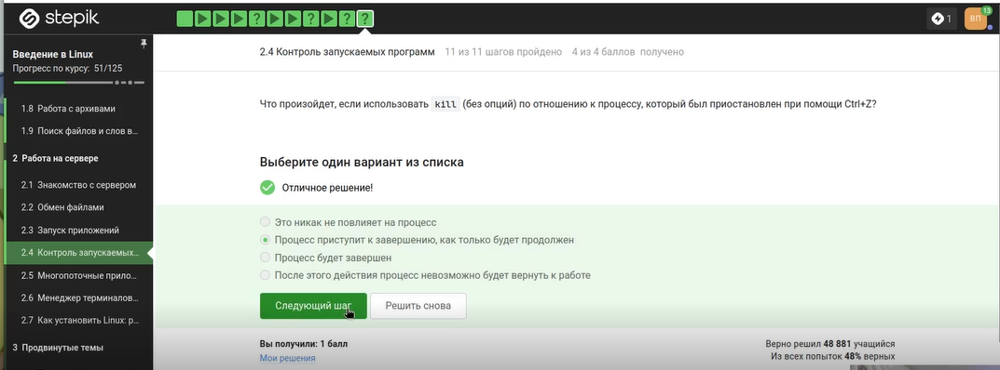

### 2.5 Многопоточные приложения

При остановке процесса (Ctrl+Z) его состояние сохраняется в памяти. При возобновлении (fg или bg) процесс продолжает работу с того же места и потребляет столько же ресурсов CPU, сколько и до остановки. Он не сбрасывается до нуля.

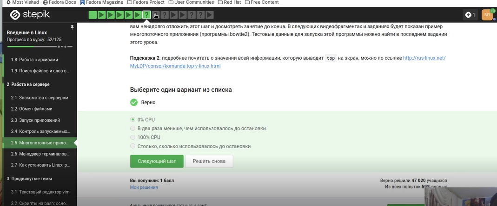

Остановка процесса через Ctrl+Z не освобождает выделенную ему память. Все данные остаются в оперативной памяти, процесс просто не получает процессорное время. Поэтому память остаётся занятой ровно в том объёме, который был на момент остановки.

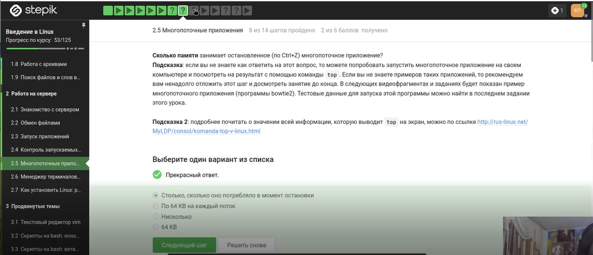

В Linux невозможно завершить один поток многопоточного процесса, не завершив весь процесс. Сигналы отправляются процессу в целом, а не отдельным потокам. Команд kill --thread или threadkill не существует.

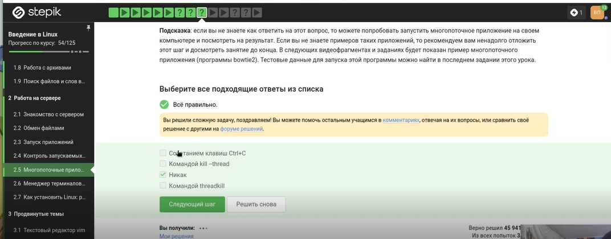

Скриншот показывает вывод команды bowtie2 --help. Видна справочная информация с описанием опций, включая -p/--threads для задания числа потоков.

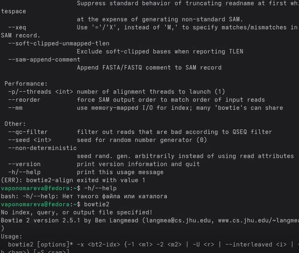

Команда bowtie2-build имеет опцию --threads для параллельного построения индекса. Команда bowtie2 имеет опцию -p/--threads для многопоточного выравнивания.

Перехожу в нужную директорию и ввожу команды, чтобы выполнить задание.

Вывод показывает результат выравнивания: 306174 рида обработано, 100% выровнялось, 99.81% выровнялись ровно один раз.

### 2.6 Менеджер терминалов tmux

Команда fg работает только в той терминальной сессии, где процесс был запущен. Если переключиться на другую вкладку (или в другой терминал), там не будет информации о процессе. Команда fg во второй вкладке либо выдаст ошибку «нет процесса», либо ничего не сделает.

Если в сессии tmux осталась только одна вкладка (окно), и в ней выполнить exit (или закрыть последний процесс в ней), то эта вкладка закроется. Поскольку вкладок больше нет, сессия завершается, и tmux прекращает работу.

Это ключевая особенность tmux — он работает как серверный процесс независимо от терминального клиента. При обрыве SSH-соединения (закрытии терминала) tmux продолжает выполняться на сервере со всеми запущенными процессами.

При принудительном закрытии вкладки (Ctrl+B, X) tmux завершает все процессы, запущенные в этой вкладке, включая фоновые. Процесс не переносится в другую вкладку и не сохраняется.

На скриншоте показана часть справочной страницы man tmux.

Выбираю правильный ответ на основе изученной справки и отправляю его на платформу.

Запускаю tmux и проверяю на практике все утверждения.

Многократное разделение — можно комбинировать горизонтальные и вертикальные сплиты сколько угодно раз. 3 части — горизонтальный сплит создаёт две панели (верх/низ). Вертикальный сплит в одной из них делит её на две, итого три панели (одна большая, две маленькие). Закрытие части — Ctrl+B, x закрывает текущую панель.

### 2.7 Как установить Linux: расширенное руководство

Просматриваю видео и читаю информацию, так как мне хватает виртуальной машины для выполнения заданий и на моём компьютере установлена другая ОС, то установка Linux не требуется.

---

## Этап 3: Продвинутые темы

### 3.1 Текстовый редактор vim

Выбираю ответ :q и затем Enter, так как именно эта команда в нормальном режиме позволит выйти из редактора если не было изменений.

Выбираю именно этот пункт, потому что проверила в vim все утверждения.

Из предложенных вариантов правильными признаны xxxxxxxxwyPp, d2w$bifour four Esc, d2wwywPp и d2wwifour four Esc, так как они преобразуют one two three four five в three four four four five.

Введена команда :%s/Windows/Linux/. Она заменяет только первое вхождение Windows в каждой строке, что соответствует условию.

Верны: можно использовать d и y, можно использовать команды перемещения, внизу экрана появляется надпись -- VISUAL --. Нужно нажать v из нормального режима, а выходить — один раз Esc.

### 3.2 Скрипты на bash: основы

Выбран ответ «Только из набора C». Каждая оболочка имеет свою историю, команды из родительских оболочек не видны.

Выбран путь /home/bi/file1.txt, потому что touch file1.txt выполняется после cd /home/bi/, а последующая смена директории не перемещает файл.

Правильные: variable123, variable, variable_123. Имя может начинаться с буквы или подчёркивания, содержать цифры не в начале.

Скрипт выводит Arguments are: $1=первый $2=второй, используя $1 и $2. Знаки $ перед 1 и 2 экранированы для вывода буквально.

### 3.3 Скрипты на bash: ветвления и циклы

Проверяю команды в терминале и отмечаю те, которые вывели True.

При var=3 выведет four, при var=5 — four.

Скрипт выводит количество студентов: 0 → No students, 1 → 1 student, 2–4 → N students, остальное → A lot of students.

Цикл прошёл по трём элементам a, b, c_d, но из-за условия $str > "c" continue никогда не сработал, поэтому каждый раз выводились start и finish.

Цикл с for str in a, b, c_d дал несколько итерации, на каждой выводились start и finish.

Скрипт определяет группу: до 10 — child, 17–25 — youth, остальные — adult. На скриншоте показан полный текст реализации.

### 3.4 Скрипты на bash: разное

Правильные команды: let "a=$a+$b", let "a = a + b", let "a+=b". Знак $ нужен при чтении переменных, но не при присваивании.

Выбран верный вариант ответа.

Выбраны два способа: сначала выполнить program, затем проверить $?; или сохранить вывод в переменную, затем проверить её.

В функции c1 объявлена как local, поэтому глобальная c1 осталась равна 0. c2 глобальная накопила 110. Вывод: counters are 0 and 110.

Пишу нужный код объясняю его.

Пишу нужный код объясняю его.

### 3.5 Продвинутый поиск и редактирование

-iname "star*" нашёл Star_Wars.avi, STARS.txt (регистронезависимо), а -name "star*" — только star_trek_0ST.mp3 и stardust.mpeg.

Верно: «find с -name найдёт меньше файлов, чем с -path». -path проверяет весь путь и может найти больше совпадений.

-mindepth 2 -maxdepth 3 находит файлы на глубине 2 и 3. file1 на глубине 2, file2 на глубине 3, file3 на глубине 4 — не найден.

Если слово есть в каждой строке, все четыре команды выведут все 10 строк. Выбран ответ: results.txt будет одинакового размера.

Выражение [xklXKL]?[uU]buntu$ находит строки, оканчивающиеся на buntu с возможной одной буквой из набора. Подходят Lubuntu is better than Ubuntu и The best OS is Xubuntu.

Без -n sed печатает каждую строку автоматически, а команда p печатает ещё раз. Выбран ответ: каждая строка будет выведена два раза.

### 3.6 Строим графики в gnuplot

Опция -p или --persist оставляет окна с графиками открытыми после выхода из gnuplot.

set key autotitle columnhead использует первую строку данных как заголовок и исключает её из построения. Название — первое значение из второго столбца, точек — 9.

Правильная команда: set xtics ("point 1, value ".x1 x1, "point 2, value ".x2 x2, "point 3, value ".x3 x3). Конкатенация через . создаёт нужные подписи.

Файл изменён: отражение через -x**2-y**2, обратное вращение через +350, ускорение через pause 0.1.

Файл move_rot (89 байт) успешно загружен на Stepik.

### 3.7 Разное

Нужно получить rwx r-x r--. Верные способы: chmod u+wx; chmod g+w и chmod 764 (7=rwx, 6=rw-, 4=r--).

Команды sudo chmod o+w dir, sudo chmod a+w dir, sudo chown user dir, sudo chown user:group dir — верны.

wc считает строки, слова, байты и длину самой длинной строки. Выбраны все эти характеристики.

Команда du -sh выводит размер текущей директории в человеко-читаемом формате без лишней информации.

Самая короткая команда: mkdir dir{1..3}. Фигурные скобки создают dir1, dir2, dir3.

---

## Выводы

Мы освоили базовые, серверные и углублённые функции Linux. Все задания успешно выполнены, курс пройден. Получен полный отчёт с 99 скриншотами, оформленными по единому стандарту.

## Ссылки

- Репозиторий с отчётом и презентацией: `https://github.com/PonomarevaVA0/course_2025-2026`
