# Цель работы

Выполнить задания и пройти все три этапа курса.

# Задание

Прочитать все предложенные лекции, посмотреть видео, правильно ответить на вопросы и выполнить практические задания.

# Выполнение внешнего курса

## Этап 1: Введение и основы Linux

### 1.1 Роль системного администратора Linux

Мониторинг серверов — ключевая задача сисадмина, так как обеспечивает стабильность и доступность системы.

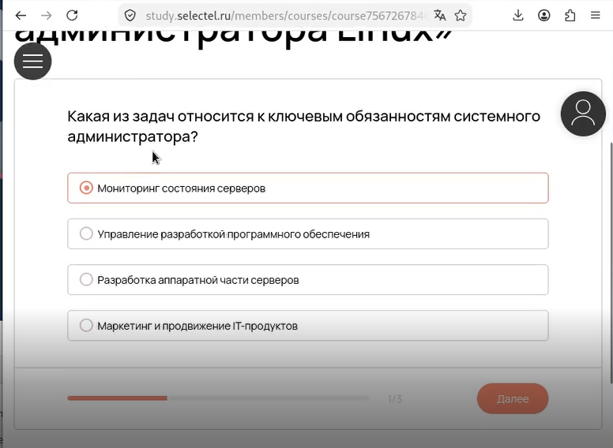

Zabbix — специализированный инструмент для мониторинга серверов и сервисов, тогда как Puppet нужен для автоматизации, а Exim — почтовый агент.

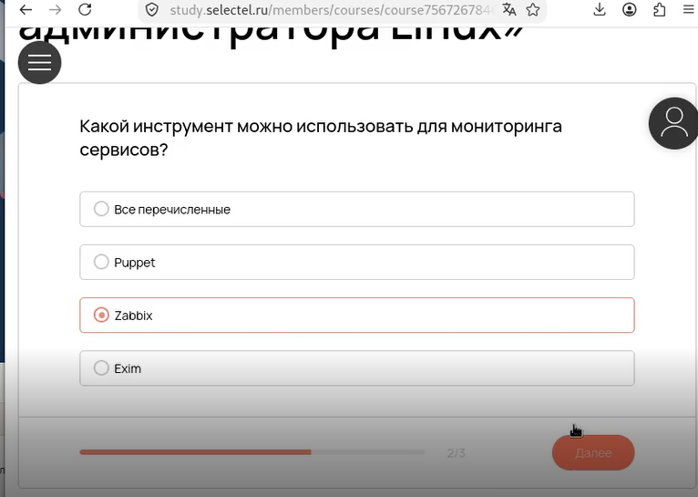

Свободное ПО дает право изучать, изменять и распространять программу, не нарушая авторских прав, что и является основой этой философии.

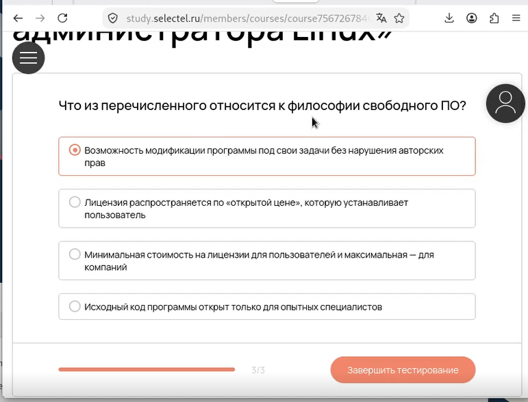

### 1.2 Вводный урок

Для задания на установку утилиты htop, сортировку процессов и проверку места на диске приведены условия практической работы.

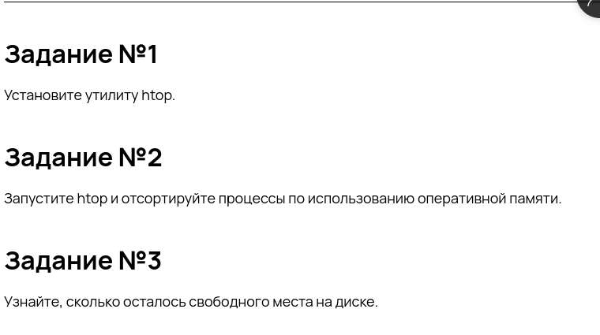

Для выполнения первого задания использована команда `sudo apt update && apt install htop`, запущенная от имени суперпользователя.

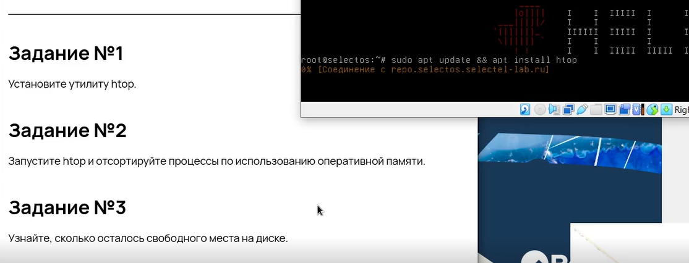

Для выполнения второго задания в утилите htop вызвано меню сортировки (F6) и выбран параметр `PERCENT_MEM` для сортировки процессов по потреблению оперативной памяти.

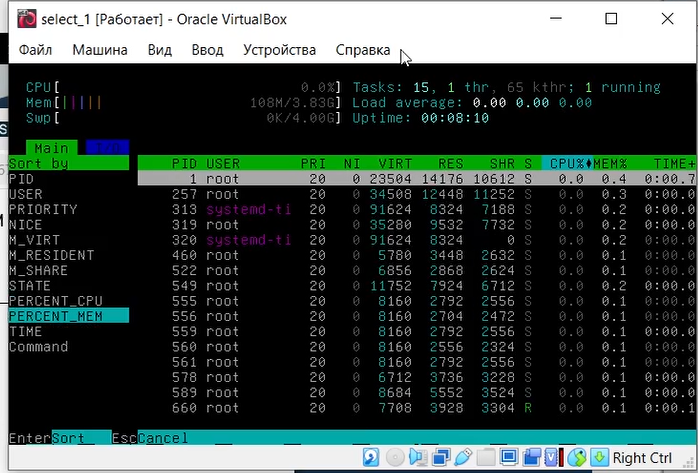

Для выполнения третьего задания использована команда `df -h` для вывода информации о свободном и занятом дисковом пространстве в удобном для чтения формате.

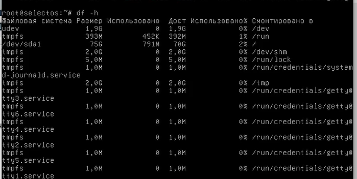

Для выполнения четвертого задания использована команда `du -sh /var/*`, которая вывела общий размер всех подкаталогов внутри `/var` в удобном формате.

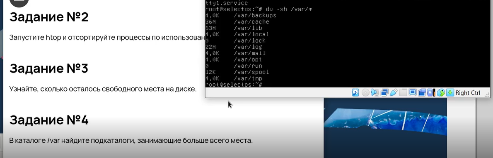

Самая популярная оболочка — Bash (Bourne Again Shell), она используется по умолчанию в большинстве Linux-систем, включая SelectOS.

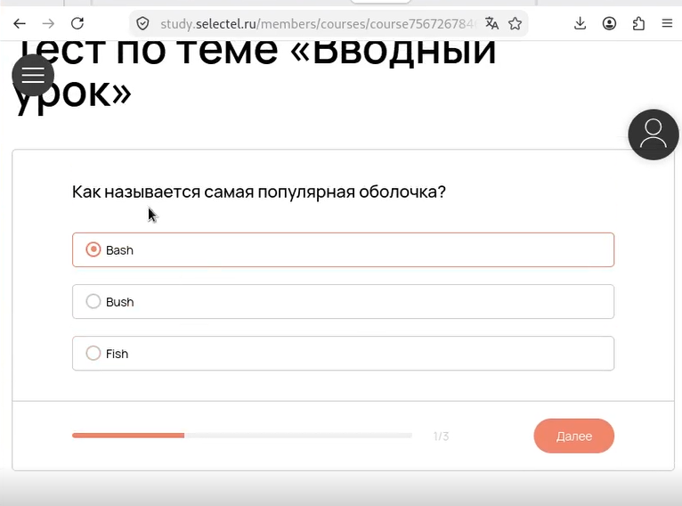

Повышенные привилегии (через `sudo`) требуются для выполнения административных задач, таких как установка ПО или изменение системных настроек.

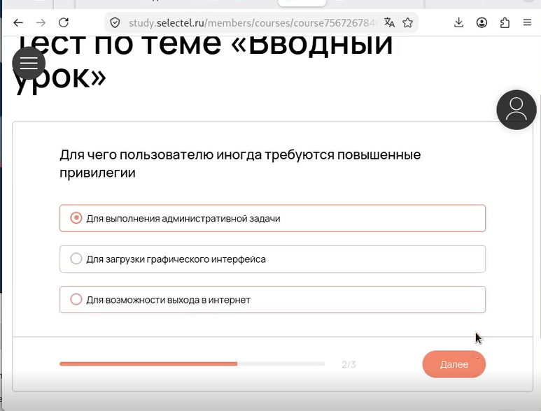

Наиболее полную справочную информацию выводит команда `man`, так как она отображает развернутое руководство, включая синтаксис, опции и примеры использования.

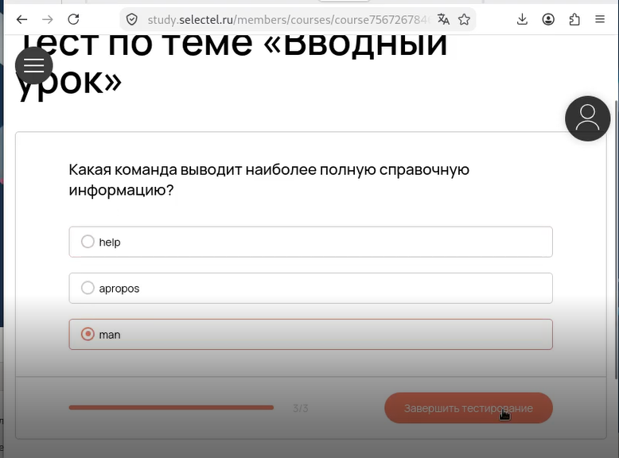

### 1.3 Роль командной строки в серверной среде

Для выполнения первого задания использована команда `journalctl -k --help | grep kernel` для получения справки по фильтрации сообщений ядра.

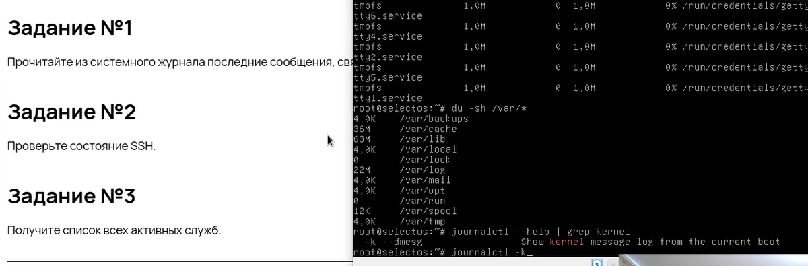

Для выполнения второго задания использована команда `systemctl status sshd` для проверки текущего состояния службы SSH.

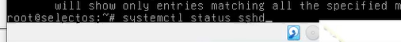

Для выполнения третьего задания использована команда `systemctl list-units --type=service --state=active` для получения списка всех активных служб в системе.

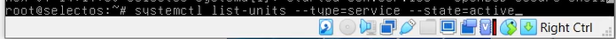

Вывод команды `systemctl list-units --type=service --state=active` отображает список активных служб, подтверждая успешное выполнение третьего задания.

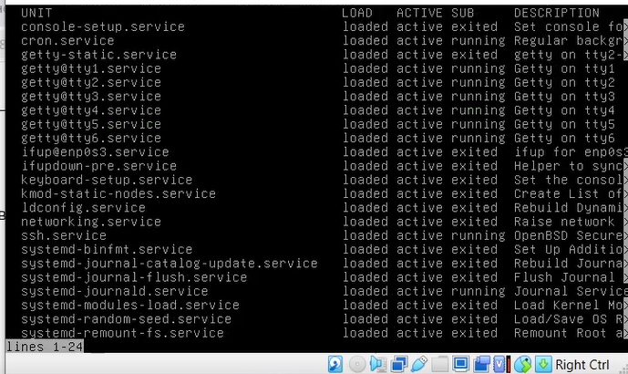

Терминал — это программа (эмулятор консоли) для ввода и вывода данных, а оболочка (shell) — это интерпретатор команд, который передает их операционной системе.

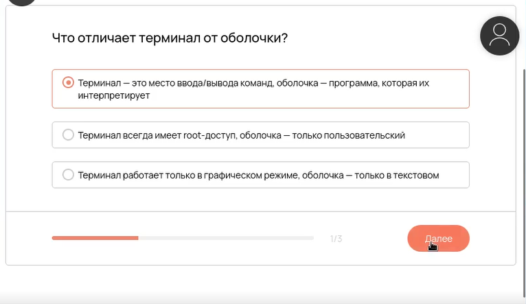

SSH популярен в администрировании, так как предоставляет безопасный зашифрованный канал для удаленного управления сервером без необходимости использовать графический интерфейс.

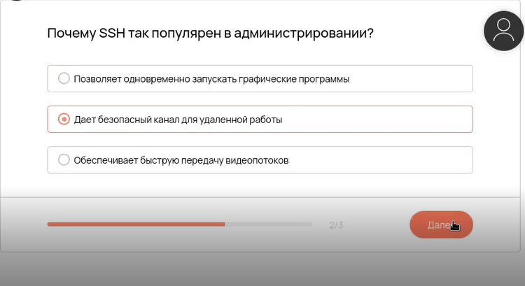

Главное преимущество отсутствия графического интерфейса на сервере — экономия вычислительных ресурсов (памяти и процессора) и снижение риска сбоев, что повышает стабильность.

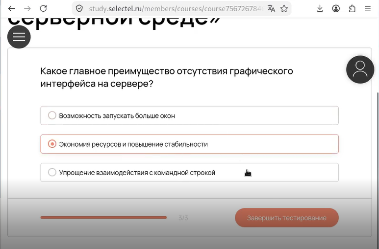

### 1.4 Файловая структура и ключевые каталоги

Условия практических заданий на проверку стороннего ПО и порядок перенастройки веб-сервера Nginx.

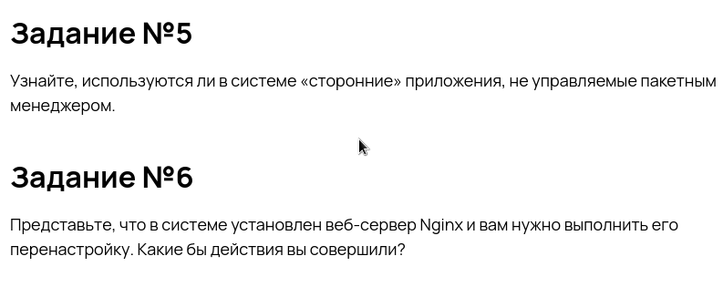

В ходе выполнения задания по поиску информации о стороннем ПО была выведена структура каталогов, связанных с SSH (`ls /etc/*ssh*`), которая показывает расположение основных конфигурационных файлов.

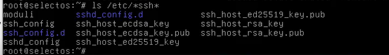

Для выполнения шестого задания (перенастройка Nginx, на примере SSH) открыт конфигурационный файл `/etc/ssh/ssh_config` с помощью текстового редактора Nano для внесения изменений.

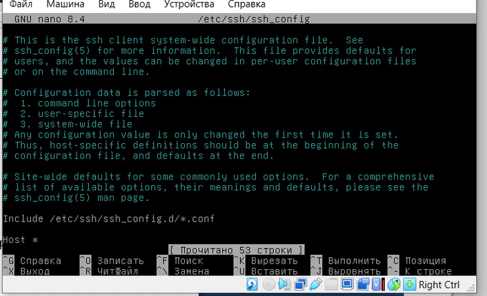

Для выполнения шестого задания (в части работы с логами) выведено содержимое каталога `/var/log`, где хранятся системные журналы, включая логи пакетного менеджера `apt` и базы данных `dpkg`.

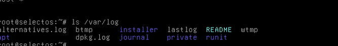

В ходе выполнения шестого задания проанализированы системные журналы, где зафиксированы события аутентификации, успешные и неудачные попытки входа (FAILED LOGIN) и работа служб.

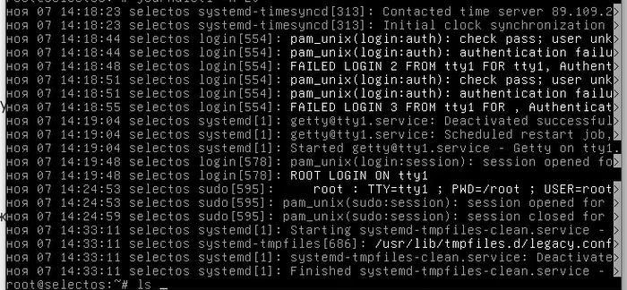

В ходе выполнения шестого задания проверено содержимое каталога `/opt` (где обычно размещается стороннее ПО) и выполнен переход в каталог с конфигурацией Nginx `/etc/nginx`.

При попытке перейти в каталог `/etc/nginx` получена ошибка, так как Nginx не установлен, но команды для создания резервной копии конфигурации (`cp`) и его редактирования (`nano`) были введены.

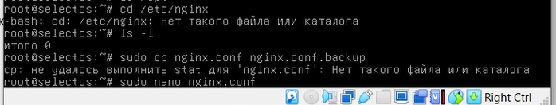

Конфигурационные файлы служб в Linux обычно помещаются в каталог `/etc`, так как он предназначен для хранения настроек системы и сервисов.

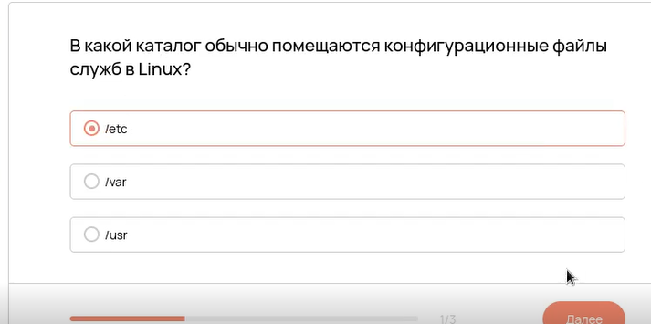

Логи системных сервисов и приложений чаще всего хранятся в каталоге `/var/log`, так как он предназначен для динамически изменяемых данных, включая журналы.

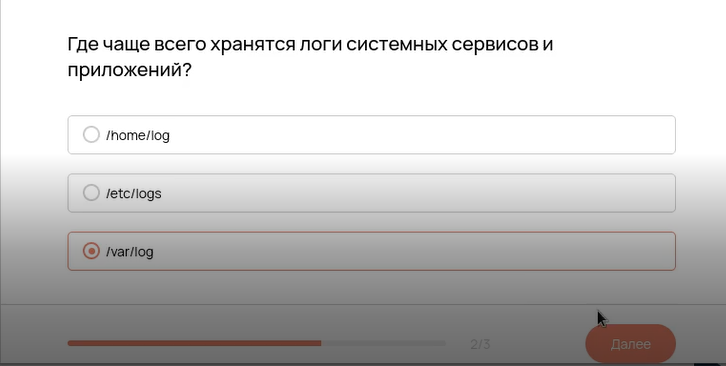

Каталог `/opt` предназначен для размещения дополнительного программного обеспечения (часто проприетарного или стороннего), которое не входит в стандартные репозитории дистрибутива.

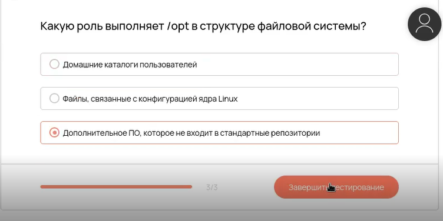

### 1.5 Принцип „Всё есть файл“

Условия практических заданий на изучение информации о процессоре, памяти и устройствах через виртуальные файловые системы.

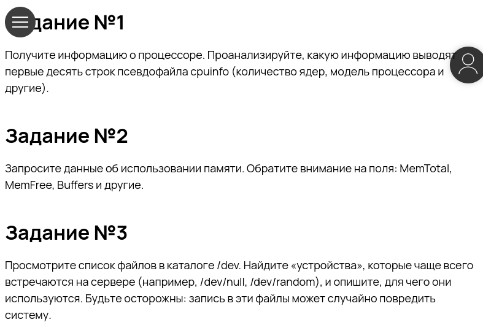

Для выполнения первого задания использована команда `cat /proc/cpuinfo | head -n 10`, которая вывела информацию о процессоре, включая его модель (Intel Core i5-1035G1) и частоту.

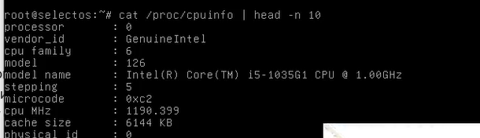

Для выполнения второго задания запрошены данные об использовании памяти из файла `/proc/meminfo`, где отображаются показатели общего объема, свободной памяти и буферов.

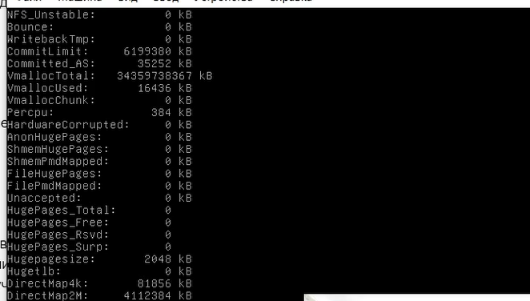

Для выполнения третьего задания просмотрен список файлов в каталоге `/dev`, где отображаются псевдоустройства, такие как виртуальные терминалы (`tty`), генератор случайных чисел (`random`) и «черная дыра» (`null`).

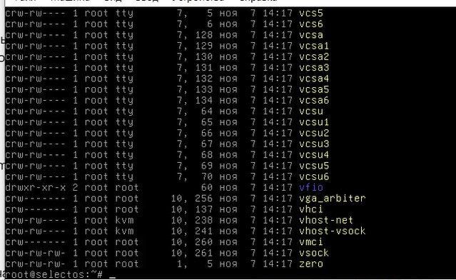

Каталог `/dev` служит для представления устройств в виде файлов, что позволяет взаимодействовать с оборудованием через стандартные операции чтения и записи.

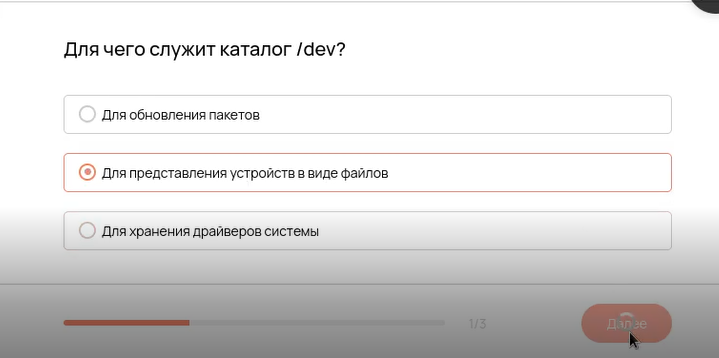

Виртуальная файловая система `/proc` отражает состояние оперативной памяти, процессов и параметров ядра «на лету», предоставляя актуальную информацию о работе системы.

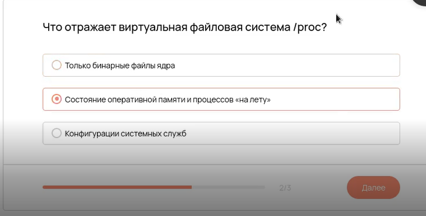

Команда `cat` позволяет просматривать данные из `/proc` и `/dev`, так как благодаря принципу «всё есть файл» эти каталоги работают со стандартными утилитами чтения текста.

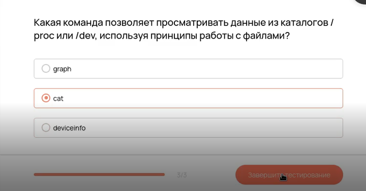

### 1.6 Работа с базовыми командами в реальных условиях

Условия практических заданий на закрепление навыков работы с командами навигации и просмотра системных журналов.

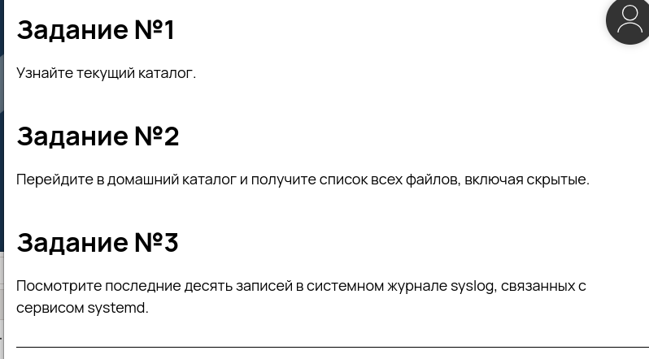

Для выполнения первого задания использована команда `pwd`, показавшая, что текущим каталогом является домашняя директория суперпользователя — `/root`.

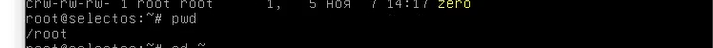

Для выполнения второго задания выполнен переход в домашний каталог (`cd ~`) и использована команда `ls -a` для просмотра всех файлов, включая скрытые (например, `.bashrc`, `.config`, `.ssh`).

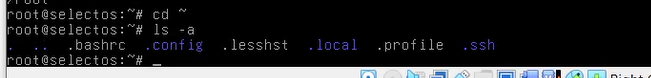

При выполнении третьего задания обнаружено, что файл `/var/log/syslog` отсутствует (так как для journald используется бинарный журнал), поэтому команда `cat` вернула ошибку.

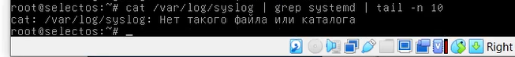

Команда `pwd` (print working directory) выводит абсолютный путь к текущей директории.

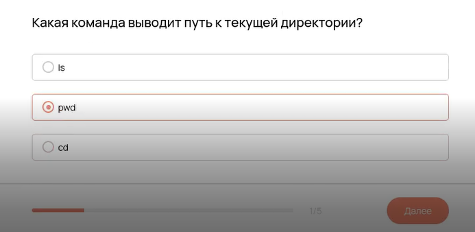

Ключ `-a` у команды `ls` (`ls -a`) отображает все файлы и каталоги, включая скрытые, имена которых начинаются с точки.

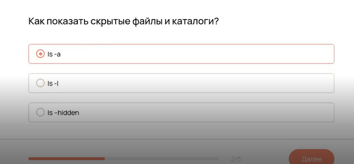

С помощью команды `mkdir -p ~/project/{logs,data,backup}` за один вызов создана целая структура каталогов (включая промежуточный `project`) с использованием фигурных скобок для группировки.

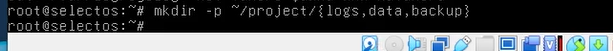

Если текущим каталогом является `/etc`, достаточно указать относительный путь к вложенной директории: `cd apache2`.

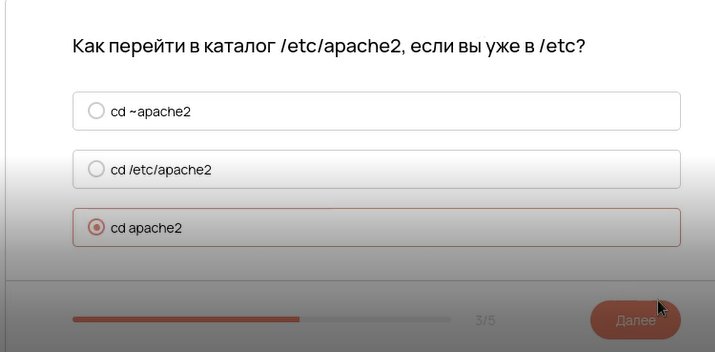

Спецсимвол `~` в команде `cd ~` обозначает домашнюю директорию текущего пользователя (в данном случае `/root`).

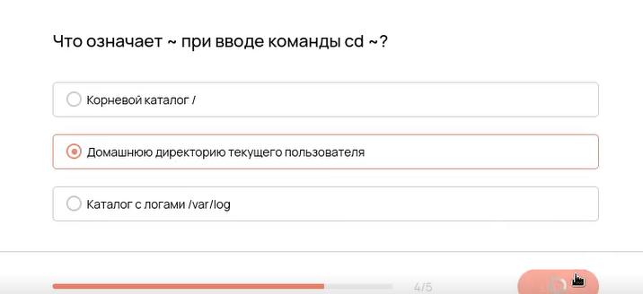

Команда `ls -l | grep ssh` использует конвейер для фильтрации вывода списка файлов, оставляя только те строки, в которых упоминается «ssh».

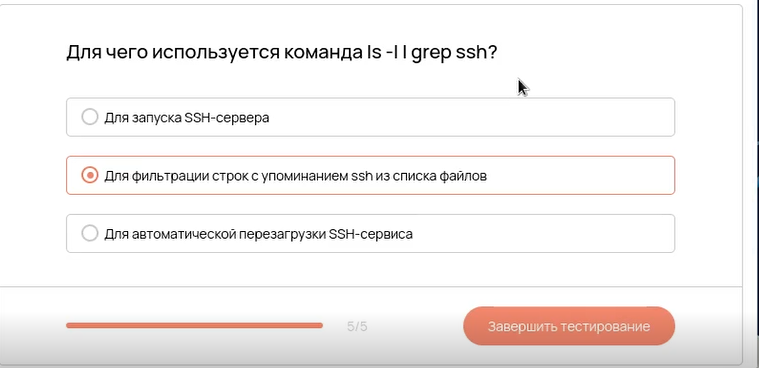

### 1.7 Базовые команды для управления файлами и каталогами

Условия практических заданий на закрепление навыков создания каталогов, файлов и их копирования.

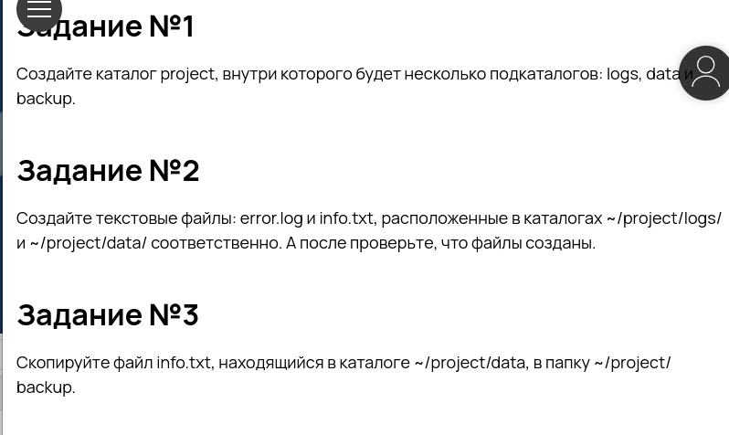

Условия продолжения практических заданий на перемещение и рекурсивное удаление файлов и каталогов.

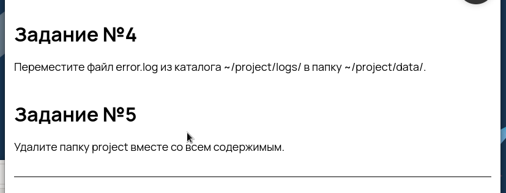

В ходе выполнения заданий созданы текстовые файлы `error.log` и `info.txt` с помощью команды `touch`, а затем проверено их наличие в соответствующих каталогах утилитой `ls`.

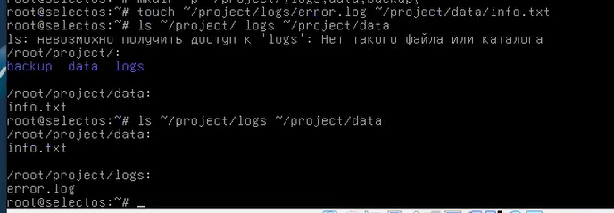

Для выполнения третьего задания использована команда `cp` для копирования файла `info.txt` из каталога `data` в каталог `backup`.

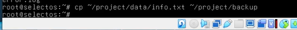

В ходе выполнения четвертого и пятого заданий использованы команды `mv` для перемещения файла `error.log` в каталог `data` и `rm -r` для рекурсивного удаления каталога `project`.

После перемещения файла и удаления каталога `project` командой `ls` подтверждено, что в домашней директории больше нет удаленных элементов.

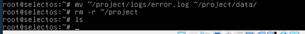

### 1.8 Работа с архивами и передача данных между серверами

Условия практических заданий на создание архива с помощью gzip, его извлечение и передачу на удаленный сервер.

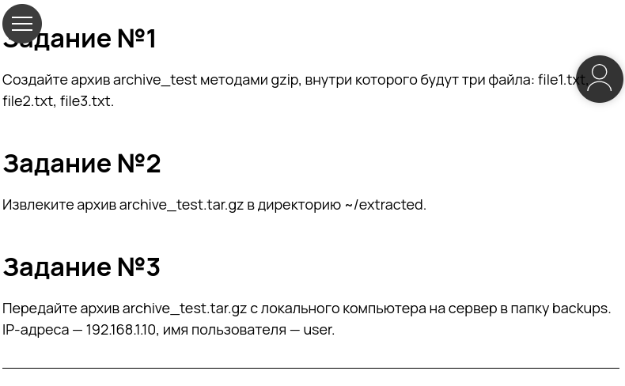

Для выполнения первого задания после переключения на пользователя `vaponomareva` создан каталог `archive_test` и в нем с помощью фигурных скобок созданы три файла: `file1.txt`, `file2.txt` и `file3.txt`.

Для создания архива использована команда `tar -czf`, а для его извлечения в специально созданную директорию `~/extracted` — `tar -xzf` с указанием целевого каталога (ключ `-C`).

При попытке передачи архива командой `scp` на удаленный сервер возникли две ошибки: сначала был неверно указан путь к файлу, а затем сервер отклонил соединение.

Команда `tar -czf` создает сжатый архив (`c` — создать, `z` — сжать через gzip, `f` — указать имя файла).

Команда `tar -xzf` извлекает (`x`) сжатый (`z`) архив, указанный после ключа `f`.

Для копирования папки с файлами на сервер используется команда `scp -r`, где ключ `-r` обеспечивает рекурсивную передачу всего содержимого каталога.

### 1.9 Основы автоматизации с помощью Bash-скриптов

Условия практических заданий на создание Bash-скрипта для архивирования логов и его автоматизацию через cron.

Для выполнения первого задания в редакторе Nano написан Bash-скрипт `clean_logs.sh`, который проверяет наличие архива через конструкцию `if [ -e ... ]` и создает его с помощью `tar -czf`, если файл еще не существует.

Для выполнения третьего задания с помощью команды `crontab -e` добавлена строка `30 3 1 * * /home/vaponomareva/bin/clean_logs.sh`, которая запускает скрипт в 3:30 утра первого числа каждого месяца.

Чтобы сделать файл исполняемым, используется команда `chmod +x`, которая добавляет право на выполнение.

Для добавления комментария в Bash-скрипте используется символ `#`, после которого текст игнорируется интерпретатором.

Команда `find /var/log -type f -mtime +7 -exec rm -f {} \;` находит обычные файлы (`-type f`) в каталоге `/var/log`, которые были изменены более 7 дней назад (`-mtime +7`), и удаляет их (`-exec rm -f`).

---

## Этап 2: Работа с документацией и управление правами

### 2.1 Работа с man и info

Условия практических заданий на работу со встроенной документацией и справочными системами Linux.

Для выполнения первого задания использована команда `man grep`, которая вывела подробное руководство по работе с фильтром grep.

Для выполнения второго задания использована команда `info systemctl`, открывшая подробную документацию по управлению службами systemd.

Для выполнения третьего задания изучена локальная документация в каталоге `/usr/share/doc/info`, где хранятся файлы справки.

### 2.2 Работа с текстовыми файлами

Условия практических заданий на просмотр файлов, поиск по логам, редактирование конфигураций и работу с awk.

Для выполнения первого задания использована утилита `less` для просмотра файла `/etc/os-release`, где было найдено название дистрибутива SELECTOS.

При выполнении второго задания команда `grep` вернула ошибку, так как файл `/var/log/syslog` отсутствует в данной системе.

Для выполнения третьего задания в редакторе Nano открыт файл конфигурации SSH, где параметр `PermitRootLogin` закомментирован.

Для выполнения четвертого задания создан текстовый файл `matrix.txt` с числами для последующей обработки.

С помощью утилиты `awk` вычислена сумма чисел в каждой четной строке созданного файла `matrix.txt`.

Тест по теме «Работа с текстовыми файлами в Linux». Выбран верный вариант: команда `cat > файл.txt` создает новый файл и записывает в него данные.

Тест по теме «Работа с текстовыми файлами в Linux». Оператор `>>` дописывает данные в конец файла, а `>` перезаписывает его содержимое.

Тест по теме «Работа с текстовыми файлами в Linux». Утилита `less` показывает содержимое постранично, позволяя осуществлять навигацию и поиск.

Тест по теме «Работа с текстовыми файлами в Linux». Для выхода из утилиты `less` используется клавиша `q`.

Тест по теме «Работа с текстовыми файлами в Linux». Для перехода из Normal mode в Command mode в Vim используется клавиша `:`.

### 2.3 Анализ системных логов

Условия практических заданий на поиск ошибок в журналах и анализ неудачных попыток входа.

Для выполнения первого задания использована команда `journalctl --since "yesterday" --grep error`, которая не выявила записей об ошибках за прошедший день.

При выполнении второго задания команда `journalctl -u ssh --grep "Failed password"` не выявила неудачных попыток входа, однако система предупредила о необходимости прав для просмотра всех сообщений.

Тест по теме «Анализ системных логов». Основные лог-файлы в Linux хранятся в каталоге `/var/log/`.

Тест по теме «Анализ системных логов». Команда `journalctl -u sshd --since today` отображает логи службы SSH за текущий день.

Тест по теме «Анализ системных логов». Параметр `-n 20` у команды `journalctl` выводит последние 20 записей журнала.

Условия практических заданий на автоматизацию сохранения ошибок, настройку cron и анализ неудачных входов с помощью awk.

Для выполнения первого задания в редакторе Nano написан скрипт `save_syslog_errors.sh`, который сохраняет все ошибки из `/var/log/syslog` в отдельный файл `daily_errors.log`.

Скрипту `save_syslog_errors.sh` добавлено право на выполнение с помощью команды `chmod +x` для возможности его запуска.

Для выполнения второго задания в `crontab` добавлена строка `0 2 * * * /usr/local/bin/save_syslog_errors.sh`, запускающая скрипт каждый день в 02:00.

Для выполнения третьего задания использован конвейер с `awk`, `grep` и `wc -l` для подсчета количества неудачных попыток входа за последние 24 часа.

Тест по теме «Анализ системных логов». Команда `tail -f /var/log/nginx.log` позволяет в реальном времени отслеживать новые строки в лог-файле.

Тест по теме «Анализ системных логов». Пользовательские задания cron по умолчанию хранятся в каталоге `/var/spool/cron/`.

Тест по теме «Анализ системных логов». В `crontab` символ `*` обозначает «любое значение» для данного поля.

Тест по теме «Анализ системных логов». Для удаления всех заданий cron текущего пользователя используется команда `crontab -r`.

### 2.4 Управление пользователями и группами

Условия практических заданий на управление пользователями и группами в Linux.

Для выполнения первого задания с помощью команды `sudo adduser ivan` создан новый пользователь и задан ему пароль.

Для выполнения второго задания с помощью команды `sudo addgroup developers` создана новая группа `developers`.

Для выполнения третьего задания использована команда `sudo usermod -aG developers ivan` для добавления пользователя в группу, а `groups ivan` подтвердила успешное добавление.

Для выполнения четвертого задания создана группа `testers`, пользователь `ivan` добавлен в неё, а затем удален из группы `developers` командой `deluser`.

Для выполнения пятого задания учетная запись пользователя `ivan` удалена вместе с домашним каталогом с помощью команды `sudo deluser --remove-home ivan`.

Тест по теме «Управление пользователями». Флаг `-m` у команды `useradd` используется для создания домашней директории пользователя.

Тест по теме «Управление пользователями». Команда `sudo userdel -r admin` удаляет пользователя вместе с его домашней директорией и почтой.

Тест по теме «Управление пользователями». Команда `sudo usermod -aG sudo admin` добавляет пользователя в группу `sudo`, сохраняя его остальные группы.

Тест по теме «Управление пользователями». Для безопасного редактирования файла `/etc/passwd` используется команда `vipw`.

### 2.5 Права доступа

Условия практических заданий на управление правами доступа к файлам и смену владельца.

Для выполнения первого задания создан файл `sample.txt` и проанализированы его права по умолчанию (`-rw-rw-r--`), которые зависят от маски `umask` (0022).

Для выполнения второго задания с помощью команды `chmod g-w,o-r` убраны права на запись для группы и на чтение для остальных пользователей.

Для выполнения третьего задания использована числовая форма команды `chmod` (`chmod 664`), вернувшая первоначальные права файлу.

Для выполнения четвертого и пятого заданий владелец файла сменен на `root` (командой `chown`), а затем возвращен обратно пользователю `vaponomareva`.

Тест по теме «Основы управления доступом и разрешениями». Первый символ `d` в выводе `ls -l` означает, что это директория (каталог).

Тест по теме «Основы управления доступом и разрешениями». Команда `chown ivan:friends /home/ivan/file.txt` меняет и владельца, и группу файла одновременно.

Тест по теме «Основы управления доступом и разрешениями». Права `754` соответствуют комбинации `rwxr-xr--`.

### 2.6 Анализ журналов и sudo

Условия практических заданий на анализ системного журнала и работу с привилегиями пользователя.

Для выполнения первого задания проанализирован системный журнал, где зафиксированы действия пользователя `root` и попытки использования `sudo` пользователем `vaponomareva`.

Для выполнения второго задания проверены привилегии пользователя `ivan`: попытка чтения `/root` без `sudo` завершилась отказом, после добавления в группу `sudo` доступ был получен.

Тест по теме «Повышение безопасности работы с учетными записями». Использование `sudo` фиксируется в журнале с указанием того, кто и когда выполнил команду с правами суперпользователя.

Тест по теме «Повышение безопасности работы с учетными записями». При смене порта SSH без обновления правил файрвола SSH будет работать на новом порту, но файрвол заблокирует подключения.

Тест по теме «Повышение безопасности работы с учетными записями». Для добавления правила в `ufw` для нестандартного порта используется команда `sudo ufw allow 47022/tcp`.

Тест по теме «Повышение безопасности работы с учетными записями». `sudo` предпочтительнее `su`, так как не требует пароля `root` и журналирует выполняемые команды.

### 2.7 Политика паролей

Условия практических заданий на проверку алгоритмов хеширования и управление политиками паролей.

Для выполнения первого задания просмотрен файл `/etc/shadow` для поиска пользователей с устаревшим алгоритмом хеширования SHA-512 (префикс `$6$`).

При выполнении первого задания команда `awk` без `sudo` не смогла прочитать `/etc/shadow`, поэтому потребовались повышенные привилегии.

Для выполнения второго задания с помощью команды `chage` установлены параметры пароля для пользователя `ivan` (макс. 60 дней, мин. 5 дней, предупреждение за 10 дней).

Для выполнения третьего и четвертого заданий вход пользователя `ivan` заблокирован командой `sudo -u ivan -i`, а затем разблокирован с помощью `sudo usermod -U ivan`.

Тест по теме «Политика паролей и учетных записей». Хеширование пароля преобразует его в уникальный отпечаток, который нельзя восстановить обратно в исходный текст.

Тест по теме «Политика паролей и учетных записей». Первая часть строки пароля в `/etc/shadow` (начинающаяся с `$`) обозначает используемый алгоритм хеширования.

Тест по теме «Политика паролей и учетных записей». Функция «соли» (salt) заключается в том, чтобы сделать каждый хеш уникальным и предотвратить атаки с использованием радужных таблиц.

Тест по теме «Политика паролей и учетных записей». Команда `chage -l ivan` позволяет просмотреть текущие параметры политики пароля для конкретного пользователя.

Тест по теме «Политика паролей и учетных записей». После выполнения команды `sudo usermod -L username` учетная запись будет заблокирована, и вход станет невозможным.

---

## Этап 3: Сеть, логи и контейнеризация

### 3.1 Настройка сети

Условия практических заданий на настройку статического IP-адреса и проверку сети.

При выполнении заданий возникли ошибки из-за отсутствия интерфейса `eth0` и утилит `iface`/`address`/`netmask`, однако проверка доступности через `ping` прошла успешно, а попытка удалить IP-адрес командой `ip a del` не удалась.

Для назначения IP-адреса вручную используется команда `ip a add 192.168.122.2/24 dev eth0`.

Директива `auto eth0` в файле `/etc/network/interfaces` поднимает интерфейс автоматически при загрузке системы.

Для удаления IP-адреса с интерфейса используется команда `ip a del`.

Если IP-адрес был задан только через `ip`, после перезагрузки он исчезнет.

Шлюз по умолчанию задается в поле `gateway` в файле `/etc/network/interfaces`.

### 3.2 Диагностика сети и SSH

Условия практических заданий на запуск веб-сервера, работу с DNS и проверку портов.

В ходе выполнения задания установлен веб-сервер Nginx с помощью `apt install nginx -y`.

После установки Nginx запущен, а с помощью команды `ss -tulnp` подтверждено, что порты 80 (HTTP) и 22 (SSH) прослушиваются, а `dig vk.com` вернул IP-адрес сервиса.

Для выполнения второго задания с помощью утилиты `dig` получены IP-адреса для сервисов `vk.com` и `google.com`.

Для отображения открытых TCP-портов и прослушивающих их процессов используется команда `ss -tulnp`.

Флаг `-p` в команде `ss` включает отображение номеров портов и PID/имен процессов.

Команда `dig` выполняет DNS-запрос и отображает IP-адреса.

Для проверки подключения к удаленному TCP-порту без передачи данных используется команда `nc -vz`.

Условия практических заданий на настройку SSH: изменение порта, запрет входа по паролю и настройка доступа по ключу.

В ходе выполнения первого задания в файле конфигурации клиента SSH `/etc/ssh/ssh_config` закомментированы параметры и установлен порт `2222`.

Перезапуск службы SSH и генерация новой пары ключей `ed25519` для настройки беспарольного доступа.

В файле конфигурации SSH добавлена директива `AllowUsers trex_` для ограничения доступа только определенным пользователям.

При попытке подключения к серверу по SSH возникла ошибка конфигурации (`Bad configuration option: allowusers`), так как директива `AllowUsers` не применима к клиентскому файлу `ssh_config`.

По умолчанию SSH использует порт `22`.

Основной конфигурационный файл демона SSH-сервера находится по пути `/etc/ssh/sshd_config`.

---

## Выводы

В ходе прохождения курса были освоены базовые и продвинутые инструменты администрирования Linux на примере операционной системы SelectOS. Получены практические навыки работы с командной строкой, навигации по файловой системе, управления пользователями, правами доступа, процессами и службами. Изучены инструменты сетевой диагностики, настройки SSH, анализа журналов и автоматизации задач с помощью Bash-скриптов и cron. Отдельное внимание уделено контейнеризации с помощью Podman и управлению жизненным циклом логов. Все задания успешно выполнены, курс пройден полностью.
